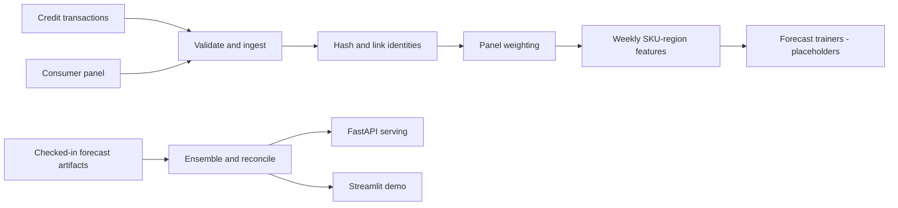

# SKU demand forecasting pipeline prototype

A Python data-pipeline prototype for linking transaction and consumer-panel data, calculating sample weights, building weekly SKU/region features, reconciling forecast artifacts, and serving saved results through FastAPI and Streamlit.

The ingestion, linking, weighting, feature, ensemble, serving and orchestration scaffolds are implemented. The LightGBM, DeepAR and PyMC training entrypoints currently raise `NotImplementedError`; this repository should not yet be presented as a complete trained forecasting system.

## Pipeline



## Implementation status

| Stage | Status | Notes |
|---|---|---|
| CSV ingestion and validation | Implemented | Writes landing Parquet artifacts |
| Hashed panel/transaction linking | Implemented | Uses a configured salt |
| Panel weighting | Implemented prototype | Uses demonstration marginals |
| Weekly feature construction | Implemented prototype | Prediction horizon still needs definition |
| LightGBM quantile training | Placeholder | Raises `NotImplementedError` |
| DeepAR training | Placeholder | Raises `NotImplementedError` |
| PyMC hierarchical training | Placeholder | Raises `NotImplementedError` |
| Ensemble/reconciliation | Implemented for available artifacts | Requires forecast files |
| FastAPI and Streamlit serving | Implemented for saved artifacts | Does not train models |
| Airflow DAG | Example scaffold | Environment-specific setup required |

## Data flow and privacy

The linking stage hashes identifiers before joining panel and transaction records. Hashing is pseudonymization, not anonymization: a weak salt or retained source identifiers can still expose people. Production use would require secret management, access controls, retention rules and a formal privacy review.

Sample data and generated Parquet artifacts are included so the pipeline shape can be inspected without claiming they represent real consumers.

## Local exploration

```bash
python -m venv .venv
source .venv/bin/activate
pip install -r requirements.txt
pip install -r requirements-dev.txt
export DATA_DIR="$PWD/examples/sample_data"
export HASH_SALT="replace-with-a-local-development-value"
```

Run the implemented preparation stages:

```bash
python -m src.ingest.ingest \
  --credit_csv "$DATA_DIR/credit.csv" \
  --panel_csv "$DATA_DIR/panel.csv"
python -m src.linking.link_panel_credit
python -m src.weighting.raking
python -m src.features.build_features
```

The checked-in forecast artifacts can be reconciled and served:

```bash
python -m src.ensemble.ensemble_and_reconcile
uvicorn src.serving.app:app --reload --port 8000
```

Do not run the documented trainer modules expecting trained output; they are explicit placeholders.

## Forecast API

The serving layer reads an existing forecast artifact and accepts a SKU, region and requested horizon. It returns saved forecast rows; it does not invoke training or generate a new statistical forecast at request time.

```bash
curl -X POST http://localhost:8000/forecast \
  -H 'Content-Type: application/json' \
  -d '{"sku":"SKU123","region":"NE","horizon_weeks":12}'
```

## Modeling boundary

`lag_1_units` is shifted by one period, but the current `rolling_4w_mean` calculation includes the contemporaneous `units_sold` value. If that feature is used to predict the same period, it leaks target information. Before implementing a trainer:

1. define the forecast origin and horizon;
2. shift every historical rolling feature behind that origin;
3. use chronological train/validation/test splits;
4. compare against seasonal-naive and moving-average baselines;
5. report error by SKU, region and demand sparsity;
6. evaluate interval calibration for quantile forecasts.

Until those decisions are implemented, the checked-in artifacts demonstrate interfaces and pipeline flow rather than validated model quality.

## Tests

```bash
pytest tests -v
```

Test source covers configuration, ingestion, linking, hashing, validation, weighting, feature construction, metrics, ensemble behavior and serving. There are no completed model-training or chronological-backtest tests because the trainers are unfinished.

## Repository map

```text
src/ingest/       CSV validation and landing artifacts
src/linking/      Hashed panel/transaction linkage
src/weighting/    Prototype panel raking
src/features/     Weekly SKU-region features
src/models/       Placeholder training entrypoints
src/ensemble/     Artifact ensemble and reconciliation
src/serving/      FastAPI forecast lookup
dags/             Example Airflow orchestration
tests/            Pipeline and serving tests
```

## Best next milestone

Implement one transparent baseline end to end—such as seasonal naive plus LightGBM quantiles—with leakage-safe features, rolling-origin evaluation, documented metrics and a forecast chart. That would add more portfolio value than introducing additional model families before the first evaluation loop is complete.
